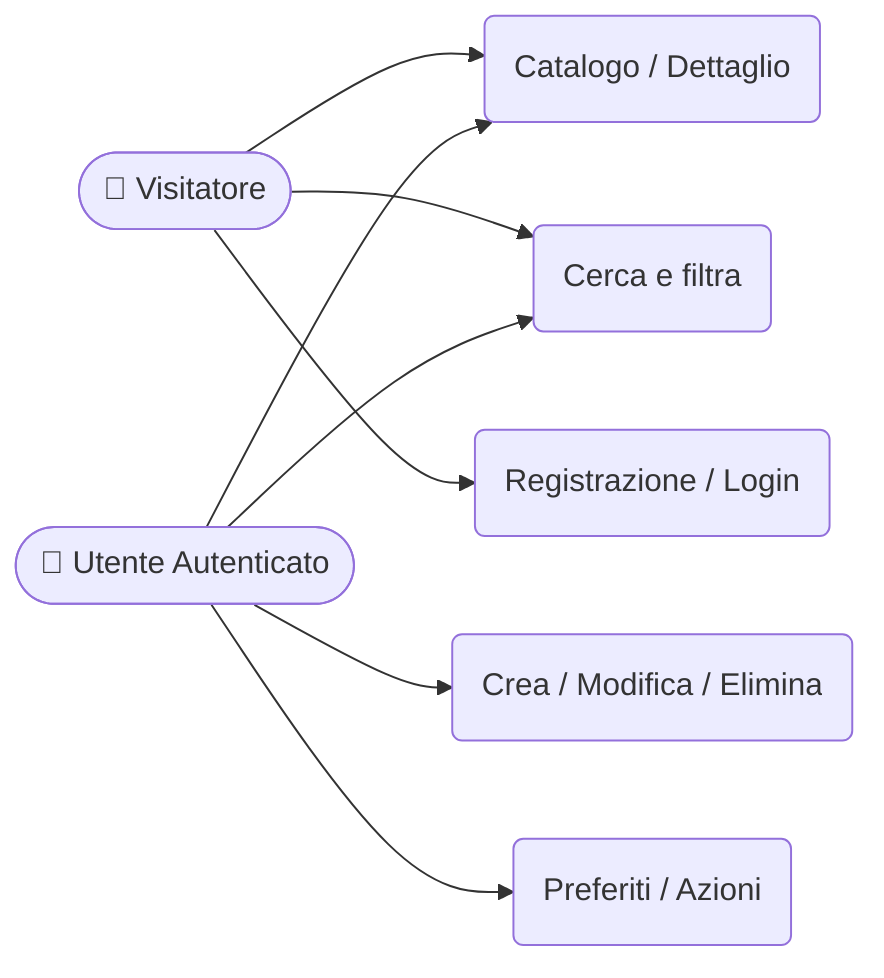
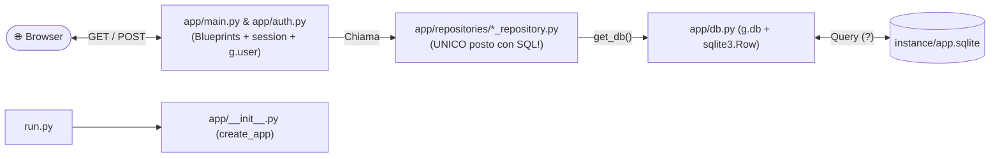
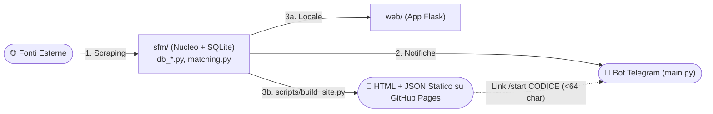

# 📚 Wiki e Regola di Sviluppo per Agents

Questa è la tua **Wiki di riferimento autonoma** per lavorare con me su qualsiasi progetto (anche in un workspace nuovo senza le cartelle dei miei vecchi progetti).
Contiene i miei appunti delle superiori, tutti gli scheletri dei progetti dei miei professori (**Angelo Galanti** e **Federico Di Luca**), lo stile obbligatorio per i `README.md`, il design frontend (**stile Awwwards**) e il deploy (**GitHub Pages**, **Vercel**, **Docker**).

> [!IMPORTANT]
> **Come usare questa Wiki**:
> 1. **Linguaggio Comune**: Usa queste definizioni, tabelle e scheletri come base perché riflettono come ragiono e programmo.
> 2. **Wiki, non gabbia rigida**: Segui questi prototipi quando calzano, oppure **ibridali, rimodellali o proponi architetture migliori** spiegandomi il *perché*.
> 3. **`README.md` Sempre Aggiornato**: **Aggiorna il `README.md` ad ogni modifica del progetto** seguendo lo stile del Prof. Federico Di Luca (Sezione 5).

---

## 1. Stack Tecnologico e Deploy

* **Core**: **Python** (OOP, `@dataclass`, type hints, CLI, `requests`, `python-telegram-bot`, `asyncio`, `pytest`), **Flask** (Application Factory, Blueprints, Repository Pattern, sessioni, cookie tecnici, `werkzeug.security`), **HTML5 + Jinja2** (`base.html`, partial `_*.html`, `flash`, `g.user`), **JavaScript** (DOM, animazioni, `fetch`).
* **Complementari**: **CSS / Tailwind** (Flexbox, Grid, Bento Grid, variabili CSS), **React + TS + Vite** (SPA/PWA Local-First con `Vitest`), **Astro** (siti statici), **SQL** (SQLite, Postgres, MariaDB, `schema.sql`, migrazioni, `JOIN`, `LEFT JOIN`, `GROUP BY`, `HAVING`), **Rust**, **JSON / Markdown / Mermaid** (API REST, `README.md`, ADR in `docs/decisions/`, UML/ER), **Docker & Bot Telegram** (`Dockerfile`, `docker-compose.yml`, `.env`).
* **Deploy**:
  1. **GitHub Pages**: Siti statici (HTML/JS, Astro), build React/TS (Vite) o siti Flask "congelati" in HTML/JSON statico (`build_site.py`). Cura percorsi relativi, `public/CNAME`, `404.html` e `.github/workflows/deploy.yml`.
  2. **Vercel**: Frontend React/TS, API serverless o Flask (`requirements.txt`, `app = create_app()`, `vercel.json`). Filesystem *effimero/read-only*: per persistenza in produzione proponi un DB cloud (Postgres/Supabase/Turso) mantenendo SQLite in locale.
  3. **Docker**: Servizi in background (**Telegram Bot**, scraper, worker, DB) con `Dockerfile` + `docker-compose.yml` + `.env` e volumi persistenti.

---

## 2. Stile Frontend: Web Design "Awwwards-Inspired"

Il frontend **non deve mai sembrare un esercizio scolastico spoglio**, ma avere un design professionale ispirato ad **Awwwards**:
1. **Tipografia Editoriale**: Google Fonts moderni (*Syne*, *Space Grotesk*, *Plus Jakarta Sans*, *Instrument Serif* per titoli; *Inter*, *DM Sans* per corpo; *JetBrains Mono* per dati/badge). Titoli fluidi con `clamp()` e tracking `-0.03em`.
2. **Palette e Superfici**: Niente colori default grezzi.
3. **Layout e Motion**: **Bento Grids**, 

---

## 3. Fase 1: Dall'Idea al Design + Appunti ER e SQL

Prima di scrivere codice, guidami nella progettazione visuale (Casi d'Uso, UML, ER):

### 3.1 Equivalenze Mentali e Metodo Grammaticale
* **Relazione** = **TABELLA** (SQL) = **Classe** (OOP) | **Colonne** = **Attributi** | **Righe (Record)** = **Oggetti / Istanze**
* **Dal testo al modello**: **Sostantivi** $\rightarrow$ Classi/Tabelle | **Caratteristiche** $\rightarrow$ Attributi/Colonne | **Verbi d'azione** $\rightarrow$ Metodi/Route/Repository | **Verbi di legame** $\rightarrow$ Relazioni (`IS-A` = Ereditarietà; `HAS-A` = Associazione).



### 3.2 Cardinalità ER e Regole di Traduzione in SQL
Simboli `erDiagram` Mermaid: `o` = **0** | `|` = **1** | `{` o `}` = **N** $\rightarrow$ `||` (**1:1**), `|{` (**1:N**), `o{` (**0:N**), `o|` (**0:1**).
1. **Entità $\rightarrow$ Tabella** con **PK (`PRIMARY KEY`)** univoca, `NOT NULL`, immutabile.
2. **Attributo $\rightarrow$ Colonna** con tipo (`INTEGER`, `TEXT`, `FLOAT`, `DATE`, `TIMESTAMP`) e vincoli (`NOT NULL`, `UNIQUE`, `DEFAULT`).
3. **Relazione 1:N (`|{` / `o{`) $\rightarrow$ Foreign Key (`FK`) sul lato "N"**: Aggiungi la PK del lato `1` come colonna `<entita>_id` (`FOREIGN KEY`) nella tabella del lato `N` (`CLASSE (1)--(N) STUDENTE` $\rightarrow$ `classe_id` in `STUDENTE`).
4. **Relazione N:N (`}|--|{`) $\rightarrow$ Tabella Intermedia**: Terza tabella con **due Foreign Key** verso le PK delle due entità.
5. **Ordine `DROP TABLE` in `schema.sql`**: **Sempre in ordine inverso** rispetto ai `CREATE TABLE` (prima le figlie con `FOREIGN KEY`, poi le principali).

### 3.3 Tabella Rapida: Dal Testo dell'Esercizio alla Query SQL

| Parola chiave / Obiettivo | Costrutto SQL | Esempio rapido |
| :--- | :--- | :--- |
| *"Elenca tutti..."* | `SELECT * FROM tabella` | `SELECT * FROM Studente ORDER BY Cognome ASC;` |
| *"Solo chi..."* (filtro righe) | `WHERE` (`=`, `>=`, `IN`, `LIKE`) | `WHERE Voto >= 28` o `WHERE Nome LIKE 'Mar%'` (`%`=0+, `_`=1 char) |
| *"Per ogni..."* (90% dei casi!) | `GROUP BY` + aggregazione | `SELECT Matricola, COUNT(*) FROM Esame GROUP BY Matricola;` |
| *"Almeno N..."* (filtro gruppi) | `GROUP BY ... HAVING` | `GROUP BY Matricola HAVING COUNT(*) >= 3;` |
| *"Quanti / Somma / Media / Max"* | `COUNT(*)`, `SUM()`, `AVG()`, `MAX()`, `MIN()` | `SELECT Corso, AVG(Voto) AS Media FROM Esame GROUP BY Corso;` |
| *"Con..."* (dati su 2+ tabelle) | `INNER JOIN ... ON PK = FK` | `FROM Studente S JOIN Esame E ON S.Matricola = E.Matricola` |
| *"Senza..."* (es. senza esami) | `LEFT JOIN ... WHERE FK IS NULL` | `FROM Studente S LEFT JOIN Esame E ON S.Matricola = E.Matricola WHERE E.ID IS NULL` |

---

## 4. Fase 2: I 7 Prototipi di Partenza (Scheletri Completi dei Progetti)

Scegliamo o combiniamo uno di questi **7 Archetipi**:
* **Prof. Angelo Galanti**: **A** (`blog_scolastico` Flask + Auth), **B** (`video-app` / `board-games-app` Flask 1:N Master-Detail), **C** (Script Python + SQLite + `@dataclass`).
* **Prof. Federico Di Luca**: **D** (`telegram-monitor` Bot Telegram + Monitor Asyncio in Docker), **E** (`school-feed-monitor` Ibrido Bot + Scraper SQLite + Flask + Static Export GitHub Pages), **F** (`profclick` / `vocabe` PWA Local-First React + TS + Vite), **G** (`federicodiluca.github.io` Sito/Portfolio statico in Astro).

---

### 4.1 Schema e Struttura Flask Classica (Archetipi A e B — `blog_scolastico` & `video-app`)


```text
nome_progetto_flask/
|- .venv/ # Ambiente virtuale Python (in .gitignore)
|- instance/ # Cartella privata per DB SQLite locale e segreti (in .gitignore)
|  '- app.sqlite # File database SQLite generato da setup_db.py
|- app/ # Pacchetto Python principale dell'app
|  |- __init__.py # Application Factory: def create_app(), configura SECRET_KEY e DATABASE
|  |- db.py # Connessione SQLite in 'g' ("zaino temporaneo"), sqlite3.Row e close_db automatico
|  |- schema.sql # DDL SQL: DROP TABLE in ordine inverso + CREATE TABLE + INSERT di esempio
|  |- main.py # Blueprint principale: rotte pubbliche, viste Master-Detail e form CRUD
|  |- auth.py # Blueprint autenticazione (Archetipo A): register, login, logout e load_logged_in_user
|  |- repositories/ # Repository Pattern: UNICO posto dove si scrivono le query SQL!
|  |  |- __init__.py # Rende repositories un sottopacchetto importabile
|  |  '- <entita>_repository.py # Funzioni CRUD con '?' che ritornano dict o liste di dict
|  |- templates/ # Template Jinja2 (base.html, index.html, detail.html, form.html)
|  '- static/ # Foglio di stile style.css (design Awwwards) e main.js
|- setup_db.py # Script che esegue app/schema.sql e crea/resetta instance/app.sqlite
|- run.py # Entry point locale: importa create_app() e avvia il server Flask
'- README.md # Documentazione del progetto sempre aggiornata
```

```python
# app/__init__.py
import os, sqlite3
from flask import Flask, current_app, g

def create_app():
    app = Flask(__name__, instance_relative_config=True)
    app.config.from_mapping(SECRET_KEY=os.environ.get("SECRET_KEY", "dev"), DATABASE=os.path.join(app.instance_path, "app.sqlite"))
    os.makedirs(app.instance_path, exist_ok=True)
    from . import db, main
    db.init_app(app); app.register_blueprint(main.bp) # Archetipo A: from . import auth; app.register_blueprint(auth.bp)
    return app

# app/db.py
def get_db():
    if "db" not in g:
        g.db = sqlite3.connect(current_app.config["DATABASE"]); g.db.row_factory = sqlite3.Row
    return g.db

def close_db(e=None):
    db = g.pop("db", None)
    if db is not None: db.close()

def init_app(app): app.teardown_appcontext(close_db)

# setup_db.py (in run.py: from app import create_app; app = create_app(); app.run(debug=True))
os.makedirs("instance", exist_ok=True)
with sqlite3.connect(os.path.join("instance", "app.sqlite")) as conn, open("app/schema.sql", encoding="utf-8") as f:
    conn.executescript(f.read())
```

---

### 4.2 Regole Archetipo A (`blog_scolastico`), B (`board-games-app` / `video-app`) e C (SQLite `@dataclass`)
* **Archetipo A (`blog_scolastico` — Auth, Sessione e Autorizzazione)**:
  - **Doppia Vita Route**: `GET` mostra il form; `POST` valida `request.form`, salva col repository o mostra `flash(error)`.
  - **Sessione ("Il Braccialetto") e Hashing**: Login salva `session['user_id'] = user['id']`; `@bp.before_app_request` popola `g.user`. Password con `generate_password_hash` e `check_password_hash` (`werkzeug.security`).
  - **Autenticazione vs Autorizzazione**: Autenticazione (`if g.user is None: return redirect(url_for('auth.login'))`); Autorizzazione (`abort(404)` se non esiste, `abort(403)` se `post['author_id'] != g.user['id']`; delete solo in `POST`).
* **Archetipo B (`board-games-app` / `video-app` — Adattamento 1:N in 5 Mosse)**:
  1. **Mappatura `OLD -> NEW`**: Mappa tabelle, colonne e tipi (`schema.sql`, `request.form.get(..., type=int)` $\rightarrow$ `request.form[...]` in `main.py` e `<input type="...">` nei template).
  2. **`app/schema.sql`**: `DROP TABLE IF EXISTS [figlia];` poi `DROP TABLE IF EXISTS [padre];` $\rightarrow$ `CREATE TABLE` con `FOREIGN KEY` $\rightarrow$ `INSERT INTO` con 3-5 record di esempio.
  3. **Repository Padre (`[padre]_repository.py`)**: `get_all_...()` (`[dict(r) for r in rows]`), `get_..._by_id(id)` (`dict(row) if row else None`), `create_...(...)` (`db.commit(); return cur.lastrowid`).
  4. **Repository Figlio (`[figlio]_repository.py`)**: `get_[figli]_by_[padre](padre_id)` e `create_[figlio](padre_id, ...)`.
  5. **Le 4 Route in `app/main.py`**: `/` (lista padri), `/<padre>/<int:id>` (dettaglio padre + lista figli), `/create_<padre>`, e `/create_<figlio>` (in `GET` passa i padri per `<select name="padre_id">`; in `POST` salva e redirige al dettaglio del padre).
* **Archetipo C (Script Python + SQLite con `@dataclass`)**: Modella ogni tabella con `@dataclass` e `typing` (`Optional`, `List`), separa `get_connection()`, `create_tables()`, `insert_...()` e query con `?`, gestendo le transazioni con `try / except / finally`, `conn.commit()`, `conn.rollback()`.

---

### 4.3 Archetipo D (`telegram-monitor` — Bot Telegram + Monitor Asyncio in Docker)
Servizio Python in Docker che risponde ai comandi Telegram (solo nella chat autorizzata) ed esegue un loop di controllo in background (`asyncio`).

```text
nome-bot-monitor/
|- Dockerfile # Immagine python:3.12-slim, installa requirements.txt e avvia CMD ["python", "src/main.py"]
|- docker-compose.yml # Servizio con restart: always, env_file: .env e bind-mount volumi (./log e file stato JSON)
|- .example.env # Template variabili (TELEGRAM_TOKEN, CHAT_ID, POLLING_INTERVAL, LOG_RETENTION_DAYS)
|- .env # Segreti reali letti da Docker e python-dotenv (in .gitignore, mai committato!)
|- current_ip.json # File JSON di stato persistito tra riavvii (creato prima di docker compose up)
|- requirements.txt # Dipendenze produzione (python-telegram-bot, python-dotenv, requests, psutil)
|- requirements-dev.txt # Dipendenze test (pytest, pytest-asyncio)
|- pytest.ini # Configurazione pytest (pythonpath = src)
|- src/ # Codice sorgente del bot e del monitor
|  |- config.py # Carica .env, converte tipi (_get_int) ed espone validate() che blocca l'avvio se mancano segreti
|  |- bot.py # Handler comandi (/start, /ip, /log, /metrics) protetti dal decoratore @authorized_only
|  |- main.py # Entry point: chiama config.validate(), avvia il task asyncio in post_init e lancia run_polling()
|  '- utils.py # Funzioni pure: chiamate HTTP, lettura/scrittura JSON e log, metriche, truncate_message (4096 char)
'- tests/ # Unit test (test_bot.py, test_config.py, test_main.py, test_utils.py) isolati dalla rete
```

```python
# Pattern chiave in src/bot.py (@authorized_only) e src/main.py (task asyncio in post_init)
def authorized_only(func):
    @wraps(func)
    async def wrapper(update: Update, context: ContextTypes.DEFAULT_TYPE, *args, **kwargs):
        if not update.effective_chat or str(update.effective_chat.id) != str(config.CHAT_ID): return
        return await func(update, context, *args, **kwargs)
    return wrapper

async def post_init(application: Application) -> None:
    application.bot_data["monitor_task"] = asyncio.create_task(monitor_loop(application))
```
* **Nota Docker**: Crea sempre i file singoli montati come volume (`echo '{}' > current_ip.json`) *prima* di `docker compose up`, altrimenti Docker li crea come cartelle.

---

### 4.4 Archetipo E (`school-feed-monitor` — Ibrido: Bot Telegram + Scraper SQLite + Sito Flask + Static Export GitHub Pages)
Architettura **"3 pezzi, un solo codice"**: bot Telegram, sito configuratore zero-account (cookie tecnici + link `/start CODICE` `<64 char`) ed esportazione statica gratuita su GitHub Pages (`build_site.py`).



```text
nome-progetto-ibrido/
|- main.py # Avvia il bot Telegram + scheduler periodico di scraping e notifiche
|- web.py # Entry point per provare il sito Flask dinamicamente in locale (127.0.0.1:5000)
|- config.example.json # Esempio configurazione fonti da monitorare, orari e parametri
|- .env.example # Template segreti (SECRET_KEY, ADMIN_TELEGRAM_ID per alert errori del bot)
|- Dockerfile & docker-compose.yml # Container del bot/scraper con volume ./data per SQLite
|- sfm/ # (o core/) Nucleo condiviso sia dal bot Telegram sia dal sito Flask
|  |- db.py & migrations.py # Connessione SQLite centralizzata e migrazioni schema all'avvio
|  |- db_*.py # Moduli dati per dominio (db_user.py, db_news.py, db_sources.py, db_health.py)
|  |- source_parser.py & news_fetcher.py # Scraping/parsing fonti, normalizzazione e deduplica
|  |- matching.py # Logica di abbinamento tra notizie/contenuti e filtri di ciascun utente
|  |- notifier.py # Invio notifiche agli utenti e alert diagnostici solo a ADMIN_TELEGRAM_ID
|  |- telegram_commands.py # Comandi bot (/start CODICE, /lista, /dati e /cancellami per GDPR)
|  '- config_link.py # Impacchetta le scelte del sito in un codice <64 char per /start del bot
|- web/ # App Flask server-side (usata in locale e come generatore per la versione statica)
|  |- __init__.py # Factory Flask, rotte pubbliche, SEO (robots.txt, sitemap.xml) e privacy
|  |- prefs.py & configurator.py # Preferenze in cookie tecnici (zero account) e creazione link bot
|  |- static/ # CSS, JS, PWA (site.webmanifest, sw.js) e card social (og-image.png, story.png)
|  '- templates/ # Template Jinja2 (base.html, index.html, configura.html e partial _*.html)
|- scripts/ # Script di automazione e staticizzazione
|  |- build_site.py # Usa il test client Flask per "congelare" HTML e JSON statici per GitHub Pages
|  |- publish_site.sh # Pubblica la cartella statica generata sul branch gh-pages
|  |- fetch_now.py # Popola subito il DB manualmente senza aspettare lo scheduler
|  '- make_og_image.py # Genera in automatico le immagini Open Graph e Instagram Story
'- tests/ # Suite pytest con fixture autouse che blocca la rete + site_check.js (test DOM jsdom)
```

---

### 4.5 Archetipo F (`profclick` / `vocabe` — Web App / PWA Local-First in React + TypeScript + Vite)
PWA **senza server proprietario** (*Local-First*), con logica di dominio pura in `src/core/` separata da React e testata con `Vitest`.

```text
nome-pwa-react/
|- index.html # Landing page pubblica statica e curata per la SEO (o entry point principale)
|- app/index.html # Entry point della PWA vera e propria (se separata dalla landing, meta noindex)
|- package.json # Script npm (dev, build, test, lint, build:icons, build:social) e dipendenze
|- vite.config.ts # Configurazione Vite + vite-plugin-pwa (Service Worker e offline)
|- vitest.config.ts # Configurazione Vitest per unit test veloci su logica pura e stato
|- src/ # Codice sorgente TypeScript / React
|  |- main.tsx # Bootstrap dell'app React e registrazione PWA
|  |- config.ts # Costanti applicative e lettura variabili VITE_* da .env.local
|  |- app/ # Shell dell'app (App.tsx, Layout.tsx, router.tsx, gestione tema chiaro/scuro)
|  |- core/ # Logica di dominio PURA in TypeScript (zero import React!) con i *.test.ts accanto
|  |- state/ # Stato React, persistenza locale (localStorage / IndexedDB) e syncEngine.ts (Google Drive)
|  |- features/ # Cartelle per schermata/funzione (es. daily/, week/, explore/, settings/)
|  |- components/ # (o ui/) Componenti UI condivisi (Button, Card, Sheet, Dialog, InstallButton PWA)
|  '- data/ # Eventuali dataset statici tipizzati in JSON (es. dizionari, collezioni)
|- public/ # Asset statici: CNAME, 404.html, robots.txt, sitemap.xml, icons/ PWA, privacy/
|- scripts/ # Script Node (.mjs/.ts) per generare icone PWA da SVG, card Open Graph, Story e SEO
|- docs/decisions/ # ADR (Architecture Decision Records): file numerati (0001-..., 0002-...) sulle scelte
'- .github/workflows/deploy.yml # CI/CD GitHub Actions: lint, test, build e deploy su GitHub Pages
```

---

### 4.6 Archetipo G (`federicodiluca.github.io` — Sito Statico / Portfolio Editoriale in Astro)
Sito statico multilingua leggerissimo in **Astro + TypeScript**, con dati strutturati separati dall'HTML.

```text
nome-sito-astro/
|- astro.config.mjs # Configurazione Astro, dominio canonical, @astrojs/sitemap e i18n (IT/EN)
|- src/ # Sorgenti del sito
|  |- consts.ts # Unica fonte di verità per dati globali (SITE_URL, contatti, social) e flag (SHOW_*)
|  |- data/site-data.ts # Dati strutturati tipizzati (progetti, esperienze, skill) separati dall'HTML
|  |- content/progetti/ # Articoli/racconti in Markdown con frontmatter validato (draft: true/false)
|  |- layouts/ # BaseLayout.astro: <head> SEO, Open Graph, JSON-LD, Header, Footer e tema dark/light
|  |- components/ # Componenti .astro modulari (Hero, ProjectCard, Timeline, ThemeToggle, Breadcrumb)
|  |- i18n/ # Dizionari di traduzione e helper per localizzazione rotte
|  |- pages/ # Routing su file (IT alla radice, EN in pages/en/, 404.astro, robots.txt.ts)
|  '- styles/global.css # Variabili CSS del tema, tipografia fluida e stili globali
|- public/ # File statici serviti alla radice (CNAME, favicon, manifest.json, icons/, images/)
'- .github/workflows/deploy.yml # GitHub Actions che compila in ./dist e pubblica su GitHub Pages
```

---

## 5. Regola Obbligatoria sul `README.md` (Stile Prof. Federico Di Luca)

> [!IMPORTANT]
> **Aggiornamento Continuo del `README.md`**:
> Crea subito il `README.md` e **aggiornalo ad ogni modifica del progetto** (nuove rotte, variabili `.env`, comandi, file o cambi architetturali).
> Segui **quasi alla lettera lo stile chiaro, asciutto e concreto del Prof. Federico Di Luca**: niente fuffa, spiega subito cosa fa il progetto, com'è fatto e come si avvia.

````markdown
# Nome del Progetto

Frase chiara e diretta (2-3 righe) che spiega cosa fa il progetto, quale problema reale risolve e per chi è pensato.

Sito / Demo: **[dominio-o-link]** · Licenza: [MIT](LICENSE)

## Com'è fatto (oppure: Come funziona)

```text
[Fonte / Browser] --> [Core / App / DB] --> [Output / Bot / Pagina]
```

- **Primo punto chiave**: spiegazione concreta in 1-2 frasi (inizia ogni bullet col concetto in **grassetto** seguito dai due punti).
- **Dove stanno i dati**: spiega la persistenza (SQLite locale, `localStorage` sul dispositivo, cookie solo tecnici).
- **Nessun account / Sicurezza**: spiega come sono protetti dati o comandi (`@authorized_only` su `CHAT_ID`, hash password, o zero dati raccolti).

## Setup e sviluppo locale

Richiede **Python 3.12+** (oppure **Node 22+** / **Docker**).

### 1. Configurazione (`.env`)
Copia `.env.example` in `.env` e compila:
- `VARIABILE_OBBLIGATORIA`: cosa rappresenta e dove si ottiene (es. token da `@BotFather`).
- `VARIABILE_OPZIONALE`: cosa regola e valore di default.

Se una variabile obbligatoria manca o non è valida, il programma termina all'avvio con un errore chiaro.

### 2. Comandi principali
```bash
python -m venv .venv && source .venv/bin/activate # crea e attiva il virtualenv
pip install -r requirements.txt # installa le dipendenze
python setup_db.py # inizializza il DB SQLite
python run.py # avvia il server su http://127.0.0.1:5000
pytest -q # esegue i test automatici
```

## Comandi del bot (se presente)

| Comando | Cosa fa |
|---|---|
| `/start` | Benvenuto e verifica configurazione |
| `/status` | Stato attuale del servizio |

## Struttura del progetto

```text
.
|- app/ # Pacchetto principale (Factory, Blueprints, Repository, Template)
|- instance/ # DB SQLite locale (ignorato da git)
|- tests/ # Test automatici pytest
|- setup_db.py # Creazione/reset del DB
'- run.py # Entry point locale
```

## Messa in produzione (Deploy)

Spiega con i comandi esatti il deploy (GitHub Actions su **GitHub Pages**, **Vercel**, o `docker compose up -d --build`).
````

---

